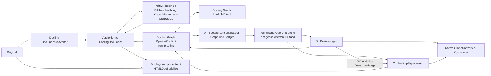

# Architektur · UX-mAInd Studio

> **Zoombare Vektor-Architekturdiagramme (`.svg`):**
> 1. [Gesamtarchitektur: Import, Docling, Re-Grounding, Dual-View, Zweitprüfung & Export (`01_master_architecture_r30.svg`)](diagrams/01_master_architecture_r30.svg)
> 2. [Stufen 01 & 02: Docling-Konvertierung & Vision (`02_docling_conversion_vision.svg`)](diagrams/02_docling_conversion_vision.svg)
> 3. [Stufe A: Evidenzextraktion & Re-Grounding (`03_stage_a_regrounding.svg`)](diagrams/03_stage_a_regrounding.svg)
> 4. [Stufen B & C: Triangulation, Epistemik & Wissensgraph (`04_stage_bc_synthesis_graph.svg`)](diagrams/04_stage_bc_synthesis_graph.svg)
> 5. [Dual-View-Quelleninspektor & A4-Übergabe (`05_dual_view_human_loop.svg`)](diagrams/05_dual_view_human_loop.svg)
> 6. [Docling-Stärken, UX-mAInd-Brücken & Systemgrenzen (`06_docling_capabilities_vs_limits.svg`)](diagrams/06_docling_capabilities_vs_limits.svg)
> 7. [Dauerhafter Arbeitsordner, Altbestand & 4-Stufen-Zweitprüfung (`07_dual_review_state_and_workspace.svg`)](diagrams/07_dual_review_state_and_workspace.svg)
> 8. [Zweitprüfung auf zwei Rechnern: Dateiübergaben & Freigabe-Schranke (`08_two_machine_exchange_and_release.svg`)](diagrams/08_two_machine_exchange_and_release.svg)

- **Konvertierung.** `DocumentConverter` speichert native JSONs und hält Originale separat. Das native JSON-Backend verarbeitet diese Dateien auch zur Bildanreicherung. Die Anwendung hält Basis, Derivat und Ergebnisse per SHA-256 zusammen und prüft die native Struktur. API-Vision nutzt Doclings `PictureDescriptionApiOptions`; CSV-Diagrammwerte können über `ChartExtractionVlmEngineOptions` und den nativen OpenAI-kompatiblen API-Engine-Typ erzeugt werden.
- **Stufe A.** `Workspace.extract` übergibt den versionierten JSON-Pfad und `UXEvidenceDocument` an `run_pipeline`. Docling Graph erledigt DocLang, Chunking, Direct/Dense/Auto, Gleaning, Validierung, Zusammenführung, Graphkonvertierung und den Provenance Ledger. `Observation` identifiziert unterschiedliche Aussagen auch bei gemeinsamem Zitat. Quellenzitate werden für die Viewer-Navigation gegen das konkrete DoclingDocument aufgelöst. Mehrdeutige oder fehlende Vorkommen bleiben als offene Zuordnungen erhalten.
- **Stufen B und C.** `interpretation.plan` bestimmt die tatsächlich quellengebundene Evidenz, menschliche Ausschlüsse, Docling-Hashes und vorhandenen Ledger-Kontext. `interpretation.run` übergibt dieselben Eingabedaten als DoclingDocument an `native_graph.run`. B verwendet `RelationshipProposals`, C `FindingHypotheses`. C kann die gültigen Relationen eines konkreten B-Laufs mit deren Reviewstatus erhalten. Ein Modellfehler in C lässt diesen B-Stand unangetastet. Die Laufquittung und Fachobjekte stehen in `ux_objects`, ältere kombinierte Einträge bleiben als historisch gemeinsame B/C-Läufe lesbar. Review bleibt append-only.
- **Provenienz und Darstellung.** Lauf-JSON enthält die nativen Modelle, den Graph, Ledger, Trace-Ereignisse und die letzten Clientdiagnosen. `evidence.py` löst einzelne Zitate, Zellpositionen und `self_ref` auf. Bei seitenweiser Verarbeitung schränkt das native Seitenereignis die Zitatsuche auf die zugehörige Seite ein. Derselbe Hash steuert native Seitenbilder, HTML, Tabellenfenster, Ressourcen und Download. PDF.js liefert Original-PDFs und Textsuche, LibreOffice bei Bedarf gekennzeichnete Office-Anzeige-PDFs. Die Docling-Seite nutzt native Komponenten und Boxen. Eine gefundene wörtliche Stelle bestätigt ihre Lage. Die inhaltliche Interpretation bleibt offen.
- **Historie.** R15-Rohdaten und Entscheidungen bleiben lesbar. R16-Beobachtungen sind mit ihren gespeicherten Laufreferenzen weiterhin zugänglich; neue Dokumentschreibvorgänge verwenden `ux-evidence/2`. Die Übergangsentscheidung steht in [ADR-0030](adr/ADR-0030-native-graph.md).

[R20-Abnahme](R20_ABNAHME.md) · [Abnahme](ACCEPTANCE.md) · [Modellzugänge](MODEL_ACCESS.md) · [R16-Nachweis](ACCEPTANCE_R16.md)

## Runtime-Stabilisierung

- `resolve_effective_model_config` erhält belegte Anbieter- oder Profilwerte. FAU-Modelle mit gemeinsamem Fenster können ihre Ausgabe bei fehlendem `max_tokens` selbst planen. Der native Strategiewert und die API-Anfrage werden getrennt angezeigt.
- `PipelineOrchestrator` verwendet die vorhandenen Stufen. Eine passive `PipelineStage` hält den nativen Kontext auch im Fehlerfall verfügbar. Der native Client meldet die SDK-Anfragegrenze über LiteLLMs `logger_fn`. Analyse zeigt Status und Ursachenklassen. Rohantwort, Trace und tatsächlich gemeldete Nutzung stehen im lokalen Laufexport.
- Konvertierung und spätere Bildanreicherung verwenden dieselbe Docling-JSON-Verarbeitung. Ein autorisierter Konvertierungsauftrag kann anschließend für Bilddokumente die native Anreicherung starten. Ein Versuch ohne neue Bildmetadaten hinterlässt einen Beleg am Basishash. Eine brauchbare abgeleitete Fassung bleibt bei der Analyse auswählbar.
- Ergebnisse und Forschungsgraph zeigen einen gemeinsamen A-, B- und C-Stand. Inkompatible historische Stände führen über ihre gespeicherten A-Läufe zur passenden Basis. Der Laufverlauf kann historische B/C-Stände mit ihren damaligen A-Läufen wiederherstellen. Die Suche nach konkreten Belegstellen und die Übergabe nativer Ledger-Chunks bleiben am jeweiligen Lauf und seiner Dokumentfassung orientiert.

## Forschungsarbeitsbereich

- Der Bestand speichert Originalkopien, bevor eine Auswahl über denselben `DocumentConverter` konvertiert wird. Der erste native JSON-Stand bleibt Basis. Wiederholte Konvertierung dokumentiert einen Versuch, abweichende Inhalte erhalten eine eigene SHA-256-Version. Gespeicherte Run-Referenzen behalten ihren Hash.
- `studio.js` hält Auswahl, Version und Navigation. `sources.js` liest den gespeicherten A-Lauf über `ux-observation` und verwendet CSS Custom Highlight für verifizierte TXT-Spannen. `pdf.js` navigiert mit PDFViewer und PDFFindController. `docling-img` zeigt die native Provenienz und HTMLDocSerializer exportiert Bild und abgeleitete Diagrammtabelle. `graph.js` untersucht die native Graphprojektion mit Cytoscape, Suche, Inspektor und Vollbild. `research.js` zeigt die gespeicherten Fachobjekte. `research.catalog` validiert A-Läufe für Anzeige, Export und B/C.
- Die manuellen Research-Formulare, die POST-Wege `ux-create` und `ux-decision` und `research.decide()` sind entfernt. Das Auflösen und Exportieren historischer Objekte und Entscheidungen bleibt Teil des Datenvertrags. Die Fortschrittsprojektion liest Bestand, Vision und A pro Dokument und zeigt pro gespeichertem B-/C-Lauf einen gemeinsamen Status.
- `research-workspace.js` verbindet die gemeinsame Dokument- und Laufwahl mit der Analyse und den Listen für Beobachtungen, Beziehungen und Findings. `graph.js` zeigt den Fachgraphen im Überblick oder im Fokus eines Befunds oder einer Beobachtung, auch ohne Beziehungs- und Finding-Läufe. Die Ansicht kann isolierte Knoten gezielt einblenden und lässt alle gespeicherten Graph-Elemente im Export verfügbar. Verlauf und Ergebnisse bieten ihre jeweiligen lokalen JSON-Exporte. Web Awesome Core wird durch den bestehenden Frontend-Build lokal gebündelt. [R21-Abnahme](R21_ABNAHME.md)
- `library.py` prüft Abhängigkeiten vor der Entfernung. Die bestätigte freie Workspace-Kopie wird innerhalb des Workspace in einen temporären Nachbarordner umbenannt, der SQL-Eintrag nach erneuter Prüfung gelöscht und anschließend die Kopie bereinigt. Bei einem Fehlschlag wird die Kopie nach Möglichkeit zurückgestellt oder ein Teilergebnis mit Restpfad ausgewiesen. Dokument-IDs werden nicht wiederverwendet. Archivierung ändert nur die Bestandsanzeige.
- Exportziel und Workspace sind getrennt. Lokale Ausgaben verwenden den Standardordner oder einen über die native Ordnerwahl gespeicherten Pfad. Der Server akzeptiert Artefaktart, IDs und Versionen. Der Workspace-Pfad fungiert als Startparameter und bleibt während des laufenden Servers gebunden.

[R18b-Abnahme und Browserbilder](R18B_ACCEPTANCE.md)

## Aufträge und Modellrollen

- Der vorhandene Workspace-Job verbindet Konvertierung, Vision und A–C. B benötigt eine gespeicherte A-Basis mit technisch auflösbaren Quellen und abgeschlossener Extraktion. A-Antwortabschluss, validierte Objekte, Quellenbindung, Graphprojektion und fachliche Prüfung werden getrennt ausgewiesen. Eine reine Abweichung der nativen A-Graphprojektion lässt die gespeicherten Beobachtungen als Basis nutzbar. Der persistierte Haltepunkt des Gesamtauftrags bleibt neben unabhängig ausgeführten Einzelschritten verfügbar. Ein Gesamtauftrag kann eine ausdrücklich gewählte geeignete A-Basis wiederverwenden.
- Der Auftragsbeleg verkettet Dokumente, Versions-Hashes und A-/B-Läufe. Zielgerichtete Wiederholung verwendet abgeschlossene Teilaufträge weiter. In einer temporären Kopie werden leere Beschreibungsplätze für Docling freigegeben. Erhaltene Beschreibungen bleiben an ihrer gespeicherten Fundstelle.
- `HTMLDocSerializer` zeichnet befüllte Tabellen in Lesereihenfolge. Wo das native Tabellenraster dünn besetzt ist, führt derselbe Serializer am Element zum bestehenden nativen Zellfenster. Die Quellenprüfung bindet ein wörtlich übereinstimmendes Mehrzellenzitat an die eindeutige native Tabellenzeile. Indirekte oder mehrdeutige Zitate bleiben offen. Die explizite Ansicht „Modellgrundlage“ liest das gespeicherte Ledger und verfügbare Texte am SDK-Eingang; reguläre Laufabfragen übertragen diese Diagnose nicht.
- Die native PipelineConfig bestimmt unter „Auto“ den Serializer. Ausdrücklich gewählte Formate bleiben wirksam. A prüft erkannte Primärinhalte gegen das Ledger einschließlich eindeutig zuordenbarer nativer Überschriften. B und C erhalten die gespeicherten Ledger-Blöcke mit Überschriften, Quelle und Geometrie in Quellenreihenfolge sowie die belegten Beobachtungen.

## Office-Struktur und Bildquellen

- Docling konvertiert die Originaldatei. Die nativen PPTX-Texte, Foliengruppen, Positionen, Tabellen und Formatinformationen bleiben an ihren Elementreferenzen erhalten. Docling 2.150.0 erkennt frei gestaltete PowerPoint-Überschriften in Textfeldern nicht zuverlässig. Ihre nativen Labels bleiben erhalten. Der PDF-basierte Weg zur Übertragung von Überschriften ist entfernt.
- LibreOffice erstellt bei Office-Dateien die Anzeige-PDF für PDF.js. Bei PowerPoint rendert derselbe Darstellungsweg auch vollständige Folien. Diese zusätzliche visuelle Quelle ist sinnvoll für Pfeile, räumliche Gruppierungen, Anmerkungen und das Verhältnis mehrerer Screenshots auf einer Folie. Docling speichert die Folie als versioniertes `PictureItem` mit nativer Seitenprovenienz und reichert dessen Pixel bei freigegebener Vision-Verarbeitung an.
- Die Bildherkunft bindet Quellart, Originaldatei, Docling-Version, Seite und `self_ref` zusammen. Ganzfolien tragen den vorhandenen LibreOffice-Beleg mit Hashes von Original und Anzeige-PDF. A erhält die Kennzeichnung mit den nativen Bildmetadaten. B und C übernehmen sie aus aufgelösten Belegen und Ledger-Blöcken. Beschreibung und Diagrammdaten bleiben abgeleitet. Mehrere Darstellungen desselben Inhalts liefern keine automatisch unabhängigen Belege. Eigenständige visuelle Details bleiben auswertbar. Forschungsgraph und JSON-Export verwenden dieselbe Herkunft.
- Word-Dateien mit DOCX, DOC oder ODT verwenden die native Erschließung und die eingebetteten Bilder. Die Seitenaufteilung eines Fließdokuments hängt von der Darstellung ab. Die LibreOffice-Seiten dienen dort der Anzeige und erzeugen keine zusätzlichen Vision-Quellen.
- `receipts.py` projiziert dokumentbezogene Rückmeldungen aus dem vorhandenen Workspace-Job und liest den gespeicherten Phasenstand. `GET /api/status` liefert den aktuellen oder letzten Auftrag. Die letzte abgeschlossene Quittung liegt in `workspace_settings`. Native Runs und Vision-Receipts halten weiterhin ihre fachlichen und technischen Daten.
- Die obere Fortschrittsanzeige zählt bearbeitete und übersprungene Schritte. Analyse zeigt sichere Zustandsmeldungen am Auftrag. Die großflächige Laufkonsole einschließlich Dokument-, Lauf- und Phasenfiltern entfällt. Lokale Rohdiagnosen bleiben über den Laufverlauf verfügbar.
- Workflow-Einstellungen speichern nur Profilnamen der vorhandenen Profile sowie die nativen Bildoptionen. Bildaufträge erkennen Kandidaten nach der Konvertierung und prüfen die Eignung. Externe Pixel benötigen ein auftragsbezogenes Einverständnis. Die erneute native Anreicherung verwendet die gespeicherte Basis.
- Der Docling-Bildbeschreibungsschritt 2.150.0 speichert den Text und gegebenenfalls Usage. Sein interner HTTP-Fehler wird beim Erzeugen der Bildbeschreibung nicht als öffentliches `ErrorItem` weitergegeben. Wo ein öffentliches ErrorItem vorliegt, werden Kategorie, Seite und ein tatsächlich enthaltener HTTP-Code sicher projiziert.
- Beobachtungen behalten exakt aufgelöste Bild- und Diagrammbelege. Bei Bildbeschriftungen folgt die Navigation der nativen `PictureItem.captions`-Referenz. Der native `GraphConverter` stellt die Bildquelle am Beobachtungsknoten dar. Die fachlichen Finding- und Relationsmodelle verwenden weiterhin die Beobachtungsreferenz.
- Der native `DiGraph` enthält je Finding-Beobachtungs-Paar eine Kante. Ihr Attribut `roles` enthält alle im Finding gespeicherten Belegrollen. Graphansicht und JSON-Export verwenden dieselbe Kante.

[R18c-Rückbau und Browserabnahme](R18C_RUECKBAU.md) · [R18c-Ausgangsabnahme](R18C_ACCEPTANCE.md) · [R22-Abnahme](R22_ABNAHME.md) · [R23-Carbon-Implementierung](R23_CARBON_IMPLEMENTATION.md)

## R23 Carbon: Epistemische Belegintegrität, Visual-Kontext & Studio-Neubau

Auf Basis des R21-Forensik-Audits und abgeglichen mit R22 (#40) ergänzt R23 die Architektur ohne Doppel-Pipelines und ohne geschlossene Fach-Whitelists:

- **Planungsbudget vs. Wire-Parameter (`ux_maind/app/models.py`, `ux_maind/app/native_graph.py`)**: `models.describe()` weist getrennte `plan_max_output_tokens` (`min(32768, max(8192, context_limit // 8))` bei geteiltem Kontextfenster) aus; `native_graph.run()` nutzt ein separates Runtime-`planning_client` für die Chunk-Planung von `docling_graph.PipelineOrchestrator`, während auf der API-Leitung `wire_max_tokens = None` (Anbieterautomatik) erhalten bleibt (`LITELLM_LOCAL_MODEL_COST_MAP=True`).
- **Eindeutige Graph-Identitäten & offene Epistemik (`ux_maind/app/templates.py`)**: `Observation`, `RelationProposal` und `FindingProposal` verwenden vollständige Identitätsfelder statt kollidierender Präfixe (`graph_id_fields`). Ergänzt um `ContextReference`, `Attribution.epistemic_role`/`referenced_person`, `Measurement.scale_direction="unknown"`/`negated=False` sowie `Observation.negated_or_struck=False`/`context_reference=None`.
- **Verlustfreie Dokument-, Tabellen-, Durchstreichungs- und Belegauflösung (`ux_maind/app/office.py`, `workspace.py`, `evidence.py`, `enrichment.py`)**: Native `w:strike`/`w:dStrike`-Erkennung in `.docx` (`docx_formatting`), partielle `strikethrough_spans` in `.pptx`, Tab-Paragraph-Erhalt statt `CodeItem` für `.txt`-Transkripte, idempotentes Ganzfolien-/Ganzseiten-Rendering (`ux_maind__page_context` via `attach_pdf_page_views`) sowie Tabellenspalten-/-zeilenheader (`ux_maind__table_headers`), Pipe-/Komma-Zeilenauflösung, begrenzte nachbarliche ODT-Absatzspannen (`adjacent_spans`), eindeutige Single-Table-Referenzauflösung (`REF_RECONCILED`), Wortgrenzen- und Header-Scoped-Messwerte.
- **Stage-B/C-Vertrag, Nicht-Doppelzählung & menschliches Review-Gate (`ux_maind/app/interpretation.py`, `a_status.py`, `research.py`, `studio.py`)**: Stage B/C laufen standardmäßig einphasig unter `extraction_contract="direct"` (`gleaning_enabled=False`) mit verlustfrei kompaktiertem Übergabedokument (`_compact_observation`, `_compact_measurement`, `_compact_context`) inkl. `Document provenance manifest` und `Excluded items summary`. `research.graph()` markiert abhängige Ganzfolien-/Eingebettet-Überlappungen (`dependent_visual_overlap`, `effective_independent_supports`), `unanchored_scale_direction`, `contains_negated_or_struck`, `unresolved_context_reference` und `technical_source_only`. `/api/ux-decision` und `research.decide()` speisen die Append-only-Tabelle `ux_decisions`.
- **PDF.js-, Cytoscape- & Ergonomie-Neubau (`ux_maind/app/web/`, `scripts/build_web.py`)**: Reparatur der PDF.js-Anzeige über absolute `#viewerContainer`-Positionierung und `ResizeObserver`/`syncVisibleLayout`, LibreOffice-Anzeigehilfen-Hinweis (`office-pdf`), synchroner Vollbildgraph mit Semantikfarben und Quick-Filtern, 3-spaltige Parameteransicht (`Native Standard` / `Planungswert` / `Wire-Parameter`) sowie lokaler Offline-Bundler `scripts/build_web.py` (`@esbuild/win32-x64`).

## R24 · Carbon UX Studio, API-Trennung, fairer `langextract`-Vergleich & Smart Drive-Sync

- **API- & Budget-Trennung (`ux_maind/app/models.py`, [`docs/API_OVERVIEW.md`](API_OVERVIEW.md), `scripts/setup_gemini_trial_key.ps1`)**: `nhr_fau` (`LLMAPI_KEY`) bleibt Open-Weights-Primärstandard; das `300 €`-Google-AI-Studio-Guthaben nutzt getrennt **`GEMINI_TRIAL_KEY`** ohne Antasten des privaten `GeminiAPI_Key` oder des `30 €`-Hochschulkontos (`ANTHROPIC_API_KEY`). [`docs/API_OVERVIEW.md`](API_OVERVIEW.md) ordnet zudem **Google Cloud Document AI** gegenüber **IBM Docling (MIT)** ein.
- **Empirischer 3-Arm-Vergleich (`scripts/benchmark_real_langextract.py`, `artifacts/r23-carbon/real_langextract_comparison.json`)**: Misst `google/langextract 1.7.2` (Rohtext) vs. `Docling -> Markdown -> langextract` vs. `UX-mAInd` (`Docling` + `Docling Graph Direct`) auf `Qwen/Qwen3.6-35B-A3B-FP8` inklusive `lx.visualize()`-HTML-Artefakten.
- **Carbon UX Studio (`ux_maind/app/web/`)**: Einheitliches `8px`/`34px`-Komponentensystem, kontextsensitiver `36px`-Workflow-Stepper außerhalb von `Analyse`, zweispaltige Master–Detail-Ergebniswerkbank, einzeilige Graph-Kommandoleiste mit `Weitere Filter`-Popover sowie 5 datenschutzklassifizierte Provider-Schnellvorlagen.
- **Smart Change-Driven Backup & Bachelorarbeit-Log ([`docs/BACHELOR_THESIS_LOG.md`](BACHELOR_THESIS_LOG.md), `scripts/sync_google_drive.py`)**: Bündelt Projektstand und Kennzahlen für das Gemini Gem (`UX_MAIND_GEM_CONTEXT.md`) sowie `UX_MAIND_PROJECT_BACKUP.zip` nur bei geänderten SHA-256-Inhalten per `gdrive` in Google Drive.

## R25 · Daylight & Obsidian Research Studio, Closed-Loop-Prüfung & Ganzstudien-Synthese

- **Semantisches Design-System (*Daylight & Obsidian*) & Barrierefreie Popover-Dropdowns (`ux_maind/app/web/studio.css`, `ux-select.js`, `i18n.js`, `graph-layout.js`)**: Vollständiges Zweifarben-System (`html[data-theme="light"|"dark"]` synchronisiert mit Web Awesome `.wa-dark` und Cytoscape-Graphpaletten), verlustfreier clientseitiger `DE ↔ EN`-Sprachwechsel (unter Aussparung wörtlicher Originalzitate in `blockquote`/`.no-i18n` sowie `#original-pane`/`#docling-pane`), kontextsensitive Seitenleiste (Dateibaum nur in `Dokumentprüfung` und `Analyse`, volle Arbeitsbreite in `Dokumente`, `Ergebnisse`, `Graph`, `Einstellungen`), durchsuchbare Floating-Popover-Selects (`ux-select.js`) anstelle nativer `<select>`-Elemente sowie eine zusammengeführte Bento-Einstellungsansicht mit Live-Umgebungsstatus (`models.env_status()` ohne Preisgabe geheimer Schlüssel) und 4-Spalten-Parameter-Matrix.
- **Geschlossener Forscher-Review-Kreislauf & Studienbericht-Export (`ux_maind/app/interpretation.py`, `research.py`, `studio.py`, `epistemic-ui.js`, `research.js`, `graph.js`)**: Menschliche Prüfentscheidungen und Begründungsnotizen (`ux_decisions`) erscheinen prominent als Callout auf Beobachtungen (A), Beziehungen (B), Findings (C) sowie direkt im Graph-Inspektor, sind über Schnellfilter (`Alle | Ungeprüft | Bestätigt | Verworfen`) filterbar, fließen über `_compact_human_decisions()` explizit in nachgelagerte B-/C-Syntheseläufe ein und lassen sich samt Originalzitaten als strukturierter Markdown-Studienbericht (`GET /api/ux-report`, `DE`/`EN`) exportieren.
- **Generische Evidenz- & Skalenpräzisierung ohne Hardcoding (`ux_maind/app/templates.py`, `evidence.py`, `research.py`)**: `Measurement.measurement_kind` (`rating_scale | count | duration | binary_or_rate | temporal | other`) und `scale_direction="not_applicable"` trennen echte Bewertungsskalen von reinen Zähl-/Zeitwerten; geordnete Mehrfach-Messwertbindung innerhalb bereits eindeutig aufgelöster Zitatspannen, Leerzeichen-/Mehrzeilen-Zellauflösung, zusammenhängende Mehrzeilen-Tabellenblöcke (`table_multi_row_candidates`), Geschwisterzellen-Header-Bindung sowie dokumentweit eindeutige `REF_RECONCILED`-Korrektur (`>= 18` Zeichen) erhöhen die Quellenauflösung auf heterogenen Umfrage-, Codebook- und Transkriptdateien ohne studienspezifische Sonderregeln.

## R26 · Modulares Open-Source-React-Studio (*Linear / Vercel Zinc & Carbon*) & Interaktiver React-Flow-Kartengraph

- **Vollständige Ablösung der Alt-Oberfläche durch modularen Open-Source-React-Stack (`frontend/src/`, `scripts/install_frontend_deps.py`, `scripts/build_web.py`)**: Die gewachsene imperative Vanilla-JS-/Web-Awesome-/Cytoscape-Schicht in `ux_maind/app/web/` entfällt gemäß Regel 3 und 8 vollständig. Das neue Studio bündelt ausschließlich OSI-permissive Open-Source-Bibliotheken (`MIT` / `ISC` / `Apache-2.0` / `BSD` — null proprietäre Pakete, null Runtime-CDNs, automatische SPDX-Lizenzprüfung in `scripts/build_web.py`): `react@18.3.1`, `@xyflow/react`, `@dagrejs/dagre`, `@tanstack/react-table`, `@radix-ui/react-{dialog,select,switch,tabs,tooltip}`, `cmdk`, `lucide-react`, `sonner`, `vaul` sowie `@docling/docling-components` und `pdfjs-dist`.
- **Anti-AI-Look Design-System (*Zinc & Carbon*, `frontend/src/studio.css`)**: Vollständiger Verzicht auf klischeehafte Indigo-/Violett-Verläufe und bunte Badge-Sammlungen zugunsten einer ruhigen, kontrastreichen Graustufen-Werkbank (`#fafafa`/`#ffffff` im Hellmodus, `#09090b`/`#111113` im Dunkelmodus, hochkontrastreiche Schwarz/Weiß-Primäraktionen, `1px`-Haarlinien und gezielte `6px`-Statuspunkte) mit deterministischer Textbegrenzung (`min-w-0`, `truncate`, `tabular-nums`).
- **Interaktiver HTML-Kartengraph statt Canvas-Rechtecken (`frontend/src/views/GraphView.jsx`)**: `@xyflow/react` und `@dagrejs/dagre` stellen `PictureSourceNode` → `ObservationNode` → `RelationNode` → `FindingNode` hierarchisch von links nach rechts als echte mehrzeilige React-Karten mit Valenz-/Review-Statuspunkt, 2-Hop-Nachbarschafts-Spotlight, MiniMap und Vollbild-Inspektor dar.
- **Live-Pipeline-Aktivitätsmonitor & Befehlspalette (`frontend/src/components/RunMonitor.jsx`, `CommandPalette.jsx`)**: Eine permanente Topbar-Statuspille öffnet per `Vaul` ein seitliches Aktivitäts-Drawer mit 5-Stufen-Timeline, Laufzeit-Timer, Dokument-Ledger und direkten `WAITING_REVIEW`-Aktionen, flankiert von `Sonner`-Toasts und einer globalen `Ctrl+K`-Befehlspalette (`cmdk`).
- **Native Docling-`2.150.0`-Spurprovenienz (`TrackSource`) & Konvertierungs-Confidence (`ux_maind/app/evidence.py`, `workspace.py`, `studio.py`, `EvidenceCard.jsx`, `InspectorView.jsx`)**: WebVTT-Interviewtranskripte (`.vtt`) bewahren ihre native Docling-`TrackSource` (`voice`, `start_time`, `end_time`) durch `model_source` (Markdown- und JSON-Übergabe ohne Veränderung des Originaldokuments) bis in den aufgelösten Beleganker und die Dual-View-Originalprüfung; endliche Qualitätskennzahlen aus Doclings `ConversionResult.confidence` (`mean_grade`, `low_grade`, `parse_score`, `layout_score`, `table_score`, `ocr_score`) werden NaN-bereinigt in `diagnostics.confidence` protokolliert.

## R27 & R28 · Dynamische API-Erkennung, Vollständige Native Docling-Einstellungen, Terminal-Verlauf & Datenübergabe-Härtung

- **Dynamischer Live-Modellkatalog & Umgebungsvariablen-Erkennung (`ux_maind/app/models.py`, `frontend/src/views/SettingsView.jsx`)**: Feste Modellvorlagen entfallen zugunsten von `detected_env_vars()` und `/api/model-catalog` (Live-Abfrage von `/models` bzw. Ollama `/api/tags` / Gemini `models` angereichert mit Kontextfenster, Ausgabelimits, Vision-Fähigkeit und Referenzpreisen über `litellm.get_model_info()`). Getrennte Schalter für `gleaning_enabled` (Stufe A) und `stage_gleaning` (Stufe B/C) sowie Chunking-, Parallelisierungs- und `dense`-Parameter sind direkt konfigurierbar.
- **Vollständig konfigurierbare native Docling-Engine ohne Hardcoding (`ux_maind/app/conversion_config.py`, `library.py`, `enrichment.py`, `workspace.py`, `frontend/src/components/DoclingSettingsTab.jsx`)**: Ein eigenständiges, flaches Modul validiert und überträgt alle 15 relevanten Parameter von `PdfPipelineOptions` und `ConvertPipelineOptions` (`do_ocr`, `force_full_page_ocr`, `replace_broken_text_layer`, `ocr_lang`, `ocr_scale`, `force_backend_text`, `do_table_structure`, `TableFormerMode` `accurate`/`fast`, `do_cell_matching`, `extract_form_fields`, `images_scale`, `heading_hierarchy`, `do_code_enrichment`, `do_formula_enrichment`, `document_timeout`, `accelerator_device`, `num_threads`) sowie frei editierbaren Vision-Prompt (`vision.prompt` inkl. `default_prompt`-Reset) und `vision.scale`. Alle Einstellungsfelder besitzen Einsteiger-Erklärungen und `ⓘ`-`InfoPopover`.
- **Entkoppeltes CLI- & Web-Terminal mit persistentem Auftragsverlauf (`ux_maind/app/terminal_ui.py`, `receipts.py`, `studio.py`, `frontend/src/views/TerminalView.jsx`)**: `ux-maind` gibt beim Start ein Systembanner und im Betrieb ein rauschfreies Echtzeit-Protokoll aus (`--verbose` für HTTP-Access-Log, `--quiet` zum Stummschalten). Im Web-Studio bietet `TerminalView` (`GET /api/job-history`, `POST /api/job-history-clear`) den chronologischen Gesamtverlauf über Konvertierungsdauer, Blockanzahl, Konfidenzgüte, Vision-Zähler, verankerte Belege, Modellkennung und Tokenverbrauch — strikt ohne Roh-Prompts, Volltexte oder API-Geheimnisse.
- **Datenübergabe- & Quellenauflösungs-Härtung (`ux_maind/app/evidence.py`, `research.py`, `interpretation.py`, `frontend/src/components/EvidenceCard.jsx`)**:
  - Exakte Zeichenspannen-Projektion (`_normalized_spans`) für Unicode-Ellipsen (`…` ↔ `...`), mathematisches Minus (`−` ↔ `-`) und HTML-Entities (`&gt;`, `&lt;`, `&amp;`) bei unveränderter Ablehnung echter Wort-Auslassungen.
  - Zeileninterne Spaltenversatz-Korrektur (`REF_RECONCILED`), dokumentweit eindeutige Kurzzitat-Korrektur (`>= 6` Zeichen inkl. `Unbekannte Docling-Referenz`), strikter Nachbar-Indexabgleich (`±2` ohne Gleichstand), O(N)-Mehrzeilen-Tabellenauflösung inkl. `Sources.select()`-Roundtrip, zusammenhängende Mehrzellenspannen in breiten Auswertungstabellen, Satzpunkt-Verbindung benachbarter Folienabsätze (`adjacent_spans`) sowie Token-Overlap-Disambiguierung für `scope`-Messwerte.
  - Echte mehrdeutige Zitate bleiben ehrlich `UNRESOLVED` und liefern bis zu 6 `candidate_anchors` für die 1-Klick-Forscherbestätigung über `/api/ux-decision`.
  - `_compact_context` erhält unzitierte Zeilen großer Tabellen (`< 45 %` Zeichenabdeckung) für Stufe B/C und reicht Intra-Dokument-Relationen (`a_relations`) sowie Bildbeschreibungen im Kontext weiter.

## R29 & R30 · Wissenschaftliche Tiefenhärtung, Editierbare Basis-Prompts, Interaktiver Wissensgraph & Synchrones In-App-Handbuch

- **Verlustfreie Schema- & Synthese-Verträge (`ux_maind/app/templates.py`, `prompts_config.py`, `native_graph.py`, `interpretation.py`)**:
  - Alle Pydantic-Feldbeschreibungen in Stufe A, B und C sind strikt `<= 240` Zeichen lang, sodass `docling_graph.llm_clients.schema_utils.build_compact_semantic_guide` kein einziges Feld (insb. `scale_direction` auf Tiefe 2) mehr abschneidet (`0` Trunkierungen). `FindingProposal` unterstützt zusätzlich etablierte UX-Taxonomien (`usability_heuristic`, z. B. Nielsen H1–H10 und ISO 9241-110).
  - Strikte Trennung von Daten und Instruktionen in Stufe B/C: `_build_synthesis_document()` erzeugt ein reines Daten-JSON (`evidence.json` inkl. `numeric_value`, `scale_direction`, `track`, `outline`, `strikethrough_spans`), während Ausgabesprache und benutzerdefinierte Regeln über `system_appendix` im System-Prompt übergeben werden.
  - Vollständige Prompt-Hoheit (`base_prompts` + `stage_prompts`): Sowohl der Standard-Basisprompt als auch optionale Zusatzanweisungen sind für Vision, A, B und C direkt in der UI editierbar und jederzeit per Klick auf Werkseinstellung zurücksetzbar.
  - Thread-sichere Anfrageprotokollierung (`_diag_lock`), mehrschichtige `httpx.Timeout`- und Chunk-Streaming-Watchdog-Überwachung ohne stille `LiteLLM × OpenAI`-Retry-Multiplikation (`US-69`), sofortige secret-freie Live-Konsolen-Events (`model_request`, `model_streaming`, `model_retry`, `structured_fallback`, `model_timeout`, `stream_stalled`, `api_error`), `structured_sparse_check=False` für prägnante B/C-Antworten, Erkennung partieller Schema-Rettungen (`SCHEMA_SALVAGED`) sowie Extraktion von `reasoning_tokens` und `cached_tokens`.
- **Präzisiertes Deterministisches Re-Grounding (`ux_maind/app/evidence.py`)**:
  - Index-erhaltende Normalisierung von PDF-Ligaturen (`fi`, `fl`, `ff`, `ffi`, `ffl`), Silbentrennungen am Zeilenende (`-\n`) und unsichtbaren Trennzeichen (`\u00ad`, `\u200b`).
  - Unabhängige linke/rechte Wortgrenzen (`_word_boundary_pattern`), sodass Prozent- und Vorzeichenwerte wie `"5%"` oder `"-2"` niemals fälschlich in `"15%"` oder `"-20"` gebunden werden.
  - Unterstützung für `KeyValueItem`/`FormItem`, sichere Serialisierung von `GRADING_SCALE`, verbundene Tabellenzell-Intervalle, deutsche Anführungszeichen (`„..."`) in Zitatlisten ohne teuren `DocumentConverter()`-Neuaufbau sowie Seitenumbruch-Spans unter Überspringen von `FURNITURE`-Kopf-/Fußzeilen.
- **Epistemische Konsistenz, Carry-Forward & Ehrliche Telemetrie (`ux_maind/app/research.py`, `models.py`, `telemetry.py`, `terminal_ui.py`)**:
  - `_finding_epistemics()` prüft alle 4 Rollenlisten (`supports`, `opposes`, `qualifies`, `improvement_evidence`), markiert verworfene Stützbelege sofort mit `contains_rejected_support`, zieht sie von den aktiven Stützzählern ab und berechnet `distinct_speakers`.
  - `carry_forward_decisions()` überträgt bestätigte menschliche Beobachtungs-Reviews per SHA-256-Fingerprint auf neue Stufe-A-Läufe derselben Dokumentversion.
  - Multimodale Open-Weight-Modelle (wie `Qwen/Qwen3.6-35B-A3B-FP8`, `Gemma-4`, `Mistral-Small-3.2`) werden präzise als `Multimodal (Text+Vision)` erkannt und können per Live-`1×1`-PNG-Probe (`POST /api/vision-probe`) verifiziert werden.
  - 100 % ehrliche Preisberechnung: FAU NHR und Ollama werden mit `0,00 $` ausgewiesen; Cloud-Referenzpreise erscheinen ausschließlich bei verifiziertem Eintrag in `litellm.model_cost` (inkl. Cache-Rabatt), andernfalls `null` (`"Kein Tarif"` statt fiktiver Schätzwerte).
  - `terminal_ui.read_job_history()` rekonstruiert bei leerem Sitzungsspeicher automatisch alle historischen Konvertierungs-, Vision-, A-, B- und C-Läufe chronologisch aus SQLite.
- **Breitbild-UI, Interaktiver Evidenzgraph, Finding-Belegleiste & In-App-Handbuch (`frontend/src/`, `docs/USER_MANUAL.md`, `docs/SYSTEM_LIMITS.md`)**:
  - Volle Flächenausnutzung (`1720px`), kompakte Einstellungszeilen mit Erklärungen in `ⓘ`-Popovern, sekündlich fluide mitwachsende Laufzeitleiste (`useFluidRuntimeProgress` in `PipelineFlowConsole.jsx` & `RunMonitor.jsx`, `US-71`), transparente Ausschlussgründe in der Pipeline, Kontaminationsschutz für Experten-Codebooks (`corpus_role='reference'` inkl. ungekürzter Spalten-Disambiguierung breiter Fragebogen-CSVs und `column_header`/`row_header`-Übergabe, `US-72`), farbige `<MiniMap>` ab 1 Knoten, projizierte `Dokumentquelle`-Karten im `Gesamtnetz`, freies Ziehen und gezieltes `"Verbindung lösen"` fehlerhafter KI-Kanten, aktive Finding-Belegleiste und `presentation`-gesteuerter Bild-/Diagrammtabellenfokus (`US-70`) im Dual-View-Inspektor, zustandsfeste Filter-/Sucherhaltung bei Rücksprung (`← Zurück`) sowie direkt in den Einstellungen lesbares Benutzerhandbuch und Systemgrenzen-Verzeichnis (`GET /api/manual`) inklusive `Nielsen H1–H10`, `ISO 9241-110:2020`, `W3C WCAG 2.2` und empirischem Modell- × Docling-Ratgeber (`US-73`, [`docs/thesis/06_ZOTERO_LITERATUR_UND_METHODIK_ABGLEICH.md`](thesis/06_ZOTERO_LITERATUR_UND_METHODIK_ABGLEICH.md)).
- **R31 Erweiterungen (`US-70` bis `US-76`)**:
  - **Prüfer-Identität & 1-Klick-Bereitstellung (`ux_maind/app/auth.py`, `install.ps1`, `install.sh`, `start-ux-maind.cmd`, `Dockerfile`, `docker-compose.yml`, `US-74`, `US-75`)**: Entkoppeltes Modul für lokal wechselbare Forscher-Profile (`LocalProfileIdentityProvider` ohne Login-Zwang im Offline-Betrieb) sowie vorbereiteten Architektur-Erweiterungspunkt `ReviewerIdentityProvider`; jede menschliche Entscheidung in `ux_decisions` trägt den aktiven `reviewer`-Stempel (`id`, `name`, `short_code`, `role`, `auth_mode`). Flankiert von plattformübergreifenden 1-Klick-Installern und einem mehrstufigen Open-Source-Container-Build.
  - **Projekt- & Daten-Landkarte ([`docs/PROJECT_STRUCTURE_AND_DATA_LOCATIONS.md`](PROJECT_STRUCTURE_AND_DATA_LOCATIONS.md), `US-76`)**: Vollständige Übersicht über Anwendungsmodule, Studienkorpora (`data/datasets/`), Evaluationsläufe (`artifacts/`), Diagramme (`docs/diagrams/`) und externe Sicherungsziele.

## R32 · Dauerhafter Arbeitsordner, Unabhängige Zweitprüfung (1 & 2 Rechner) & `ReviewerIdentityProvider`

- **Dauerhafter Standard-Arbeitsordner & `workspace-r12`- Schutz (`ux_maind/app/library.py`, `studio.py`, `terminal_ui.py`, `start-ux-maind.cmd`, `App.jsx`, `CorpusView.jsx`, `VisionPathsSettingsTabs.jsx`)**:
  - `library.default_workspace_path()` legt unter Windows dauerhaft `%LOCALAPPDATA%\UX-mAInd\workspace` (Linux/macOS: `~/.local/share/UX-mAInd/workspace`) fest; ein explizites `--workspace` behält strikten Vorrang für isolierte Entwicklungs- und Abnahmeläufe. `start-ux-maind.cmd` reicht `--port`, `--workspace` und `--no-browser` sauber durch.
  - `library.probe_legacy_workspace()` prüft beim Start schreibgeschützt (`?mode=ro`) einen vorhandenen Nachbarordner `workspace-r12` und weist im Konsolenbanner sowie in der Oberfläche auf die rückkehrfähige Übernahme per Kopie bei geschlossenem Studio hin; ein aus `workspace-r12` kopierter Standard-Ausgabepfad wird automatisch auf `workspace\exports` abgebildet.
- **Lokale Prüferprofile & Architektur-Anschlusspunkt (`ux_maind/app/auth.py`)**:
  - Der BA-Betrieb läuft zu 100 % lokal ohne Cloud-Dienst oder Login-Mauer über `LocalProfileIdentityProvider` (Anzeigename oder Kürzel `short_code` genügt; Einzelprüfung direkt mit `Standard-Prüfer`).
  - Für spätere institutionelle Mehrbenutzer-Umgebungen definiert `auth.py` das `typing.Protocol` **`ReviewerIdentityProvider`** (`list_identities(workspace)`, `active_stamp(workspace)`) samt Registrierungspunkt `set_identity_provider(provider)`. Eine angemeldete Prüferidentität (z. B. Hochschul-Shibboleth/OIDC/SAML) kann dort angeschlossen werden, ohne `ux_decisions`, `ux_review_sessions` oder die Exportschemata anzupassen.
- **Gemeinsame 4-Stufen-Engine für „Am selben Rechner" & „Auf zwei Rechnern" (`ux_maind/app/dual_review.py`, `workspace.py`, `research.py`, `telemetry.py`, `office.py`, `frontend/src/components/DualReviewPanel.jsx`, `SynthesisView.jsx`)**:
  - Persistiert Sitzungen in `ux_review_sessions` (`session_id`, `mode`, `role_on_this_machine`, `baseline_sha256`, kanonisches `baseline_json`, lokale `id_map_json`, `submitted_a_at`, `submitted_b_at`, `released_at`, `resolutions_json`, `imported_receipts_json`) und nutzt die bestehende Append-only-Tabelle `ux_decisions` (`origin='dual_review'` mit `phase='initial'|'revision'` und `decision_uid`, sowie `origin='dual_review_adopted'`).
  - **Strikte Verblindung vor Freigabe (`apply_dual_review_projection` & `_is_export_hidden_for_viewer`):** Solange `released_at IS NULL`, projiziert `research.objects()` für die aktive Person ausschließlich den eingefrorenen Ausgangsvorschlag plus deren eigene Entscheidungen — konsistent über UI, Finding-Feldkorrekturen, Historie, Wissensgraph, A4-HTML, Markdown, Forschungs-JSON und im Ausgabeordner abgelegte Dateien (`HTTP 403` für fremde verblindete Exporte). `release_comparison()` verlangt zwingend beide Ersturteile (`submitted_a_at` und `submitted_b_at`).
  - **Selbsttragender 2-Rechner-Dateiaustausch (`ux_maind.dual_review.v1`):** `export_assignment_zip()` bündelt ausgewählte Originale, versionierte `DoclingDocument`-JSONs, gecachte LibreOffice-Anzeige-PDFs (`office.cached_office_pdf`), Stufe-A-Läufe und Findings ohne jede Bewertung von Prüfer 1. Beim Import auf Rechner 2 (`_import_assignment_zip`) werden alle Datei- und Manifest-Prüfsummen vor dem ersten Schreibzugriff verifiziert und sämtliche `evidence_id`-Anker (`_rebind_run_result_for_local_doc`) deterministisch auf die lokalen Dokument-IDs von Rechner 2 umgebunden, sodass alle Originalbelege in der Dual-View ohne Verbindung zu Rechner 1 und mit `0` Sprachmodell-Aufrufen auflösen. Rückgabe (`ux-abgabe-*.json`), Vergleich (`ux-vergleich-*.json`) und Überarbeitung (`ux-ueberarbeitung-*.json`) sind über `imported_receipts` und `decision_uid` idempotent (`0` Duplikate bei erneutem Import) und weisen fremde oder beschädigte Dateien transaktional ohne Teiländerungen ab.

